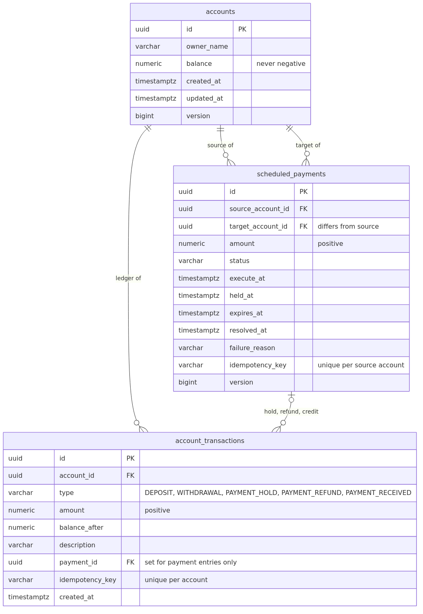

# Design

How the application is built and why: the database schema, the concurrency and idempotency strategies that keep the money correct, what happens when things fail, the security model, and how this scales and extends.

The AWS infrastructure, the delivery pipeline and the infrastructure-level trade-offs are in [docs/ARCHITECTURE.md](docs/ARCHITECTURE.md). The endpoint-by-endpoint reference is in [docs/API.md](docs/API.md).

1. [Database schema](#1-database-schema)
2. [Concurrency strategy](#2-concurrency-strategy)
3. [Idempotency strategy](#3-idempotency-strategy)
4. [Error handling and retry strategy](#4-error-handling-and-retry-strategy)
5. [Security considerations](#5-security-considerations)
6. [Scalability and future extensibility](#6-scalability-and-future-extensibility)

## 1. Database schema



Three principles shape it:

- **Money is exact.** All amounts are `NUMERIC(19,2)`, never floating point, and are handled as `BigDecimal` with exactly two decimal places in the application.
- **Every balance change leaves a trace.** A balance is only ever changed together with an entry in the append-only ledger, in the same database transaction.
- **The database enforces the invariants.** Constraints hold even if the application has a bug, and the application's database role cannot rewrite history.

### `accounts`

| Column | Type | Notes |
|---|---|---|
| `id` | `uuid` | Primary key, generated by the application |
| `owner_name` | `varchar(100)` | Not null |
| `balance` | `numeric(19,2)` | Not null, `CHECK (balance >= 0)` — an overdraft is impossible regardless of application logic |
| `created_at`, `updated_at` | `timestamptz` | Not null, taken from the application's clock |
| `version` | `bigint` | Optimistic locking (see [§2](#2-concurrency-strategy)) |

### `account_transactions` — the ledger

| Column | Type | Notes |
|---|---|---|
| `id` | `uuid` | Primary key |
| `account_id` | `uuid` | Not null, references `accounts` |
| `type` | `varchar(30)` | Not null, `CHECK` in `DEPOSIT`, `WITHDRAWAL`, `PAYMENT_HOLD`, `PAYMENT_REFUND`, `PAYMENT_RECEIVED` |
| `amount` | `numeric(19,2)` | Not null, `CHECK (amount > 0)` — the direction comes from `type`, so an amount is never negative |
| `balance_after` | `numeric(19,2)` | Not null, `CHECK (balance_after >= 0)` — each entry is self-contained for audit and reconciliation |
| `description` | `varchar(140)` | Optional free text from the client |
| `payment_id` | `uuid` | References `scheduled_payments`; a `CHECK` requires it exactly for the three payment entry types and forbids it otherwise |
| `idempotency_key` | `varchar(64)` | Unique per account (see [§3](#3-idempotency-strategy)) |
| `created_at` | `timestamptz` | Not null; defines which banking day an entry falls in |

Indexes: the primary key; `UNIQUE (account_id, idempotency_key)`; and `(account_id, created_at)`, which serves both the paged transaction history and the range scan that sums today's withdrawals.

The role the application uses has `SELECT` and `INSERT` on this table and nothing else: no `UPDATE`, no `DELETE`. A compromised or buggy application cannot rewrite the ledger. [`DatabasePrivilegesIT`](src/test/java/com/example/banking/DatabasePrivilegesIT.java) proves it by connecting as that role and asserting the failures.

### `scheduled_payments`

| Column | Type | Notes |
|---|---|---|
| `id` | `uuid` | Primary key |
| `source_account_id`, `target_account_id` | `uuid` | Not null, reference `accounts`, `CHECK (source <> target)` |
| `amount` | `numeric(19,2)` | Not null, `CHECK (amount > 0)` |
| `description` | `varchar(140)` | Optional |
| `status` | `varchar(30)` | Not null, `CHECK` in `SCHEDULED`, `PENDING_ACCEPTANCE`, `COMPLETED`, `EXPIRED`, `CANCELLED`, `FAILED` |
| `execute_at` | `timestamptz` | Not null; when the funds are to be taken (now, for an immediate payment) |
| `held_at`, `expires_at` | `timestamptz` | Set when the funds are held; a `CHECK` requires both for any status that implies funds moved |
| `resolved_at` | `timestamptz` | When the payment reached a final status |
| `failure_reason` | `varchar(255)` | Why execution failed, in terms the target account may safely see |
| `idempotency_key` | `varchar(64)` | Unique per source account |
| `created_at`, `updated_at`, `version` | | As for accounts |

Indexes: two **partial** indexes power the scheduler — `(execute_at) WHERE status = 'SCHEDULED'` and `(expires_at) WHERE status = 'PENDING_ACCEPTANCE'`. They contain only the handful of rows that are actually pending, so the polling queries stay fast however many millions of completed payments accumulate. A third index on `target_account_id` supports the incoming-payments query.

### Migrations

The schema is owned by Flyway ([`src/main/resources/db/migration`](src/main/resources/db/migration)):

| Migration | Contents |
|---|---|
| `V1__create_accounts_and_transactions.sql` | Accounts and the ledger |
| `V2__create_scheduled_payments.sql` | Payments, plus the ledger's new entry types and `payment_id` reference |
| `V3__create_application_role.sql` | The least-privilege `banking_app` role and its grants |

Rules for changing it: never edit an applied migration; grant `banking_app` the privileges any new table needs in the same migration; and keep each migration compatible with the release already running, because old tasks keep serving traffic while new ones start (expand, deploy, then contract in a later release). Hibernate runs with `ddl-auto=validate`, so a mismatch between entities and schema fails at start-up — and the migration task runs first, so it fails the deployment rather than a live task.

### Why both a balance column and a ledger

The balance could be derived by summing the ledger, which is the purist's answer and needs no reconciliation. It was rejected because reading a balance is the most common operation and would grow linearly with an account's history, and because `CHECK (balance >= 0)` is what makes an overdraft impossible at the storage layer. Keeping both means they could in principle diverge; that risk is contained by only ever writing them together in one transaction, and by `balance_after` on every entry, which makes divergence detectable by a reconciliation job ([§6](#6-scalability-and-future-extensibility)).

## 2. Concurrency strategy

Two withdrawals arriving at the same instant are the central correctness risk in this domain. Both read a balance of 100, both see today's withdrawals at 900, both conclude they are within the rules, and both write — leaving a negative balance or a day's total above the limit. Every money movement therefore follows the same pattern:

```
BEGIN
SELECT … FROM accounts WHERE id = ? FOR NO KEY UPDATE   -- row lock, held until commit
  check the idempotency key
  sum today's withdrawals and payment holds
  check the balance
  UPDATE accounts SET balance = …
  INSERT INTO account_transactions …
COMMIT                                                   -- lock released
```

`Ledger.post` is the only code that changes a balance, and `Account.credit`/`debit` are package-private so no other class can bypass it. The ledger requires an existing transaction (`Propagation.MANDATORY`), which turns "somebody forgot the transaction" into a startup-time-style failure rather than silent data loss.

**Why this is correct.** PostgreSQL's default READ COMMITTED isolation takes a fresh snapshot for every statement. A request that waits for the lock therefore sees the committed effects of the request that held it before, including its ledger entry, when it sums the day's withdrawals. Serialisation per account gives the same result as if the requests had arrived one after the other.

**Lock ordering.** Payment operations touch two rows, so they always take them in the same order — payment first, then account:

| Operation | Locks, in order |
|---|---|
| Deposit, withdrawal | Account |
| Create an immediate payment | Source account, then insert the new payment row |
| Execute a due payment | Payment (claimed with `SKIP LOCKED`), then source account |
| Accept a payment | Payment, then target account |
| Expire a payment | Payment, then source account |
| Cancel a payment | Payment |

No operation locks an account before a payment, so there is no cycle and these operations cannot deadlock each other.

**Bounded waiting.** The connection sets `lock_timeout = 5s` and `statement_timeout = 30s`, and the database sets `idle_in_transaction_session_timeout = 60s`. A request that cannot get the lock in time fails with `409 CONCURRENT_MODIFICATION` — a clear, retryable answer instead of threads piling up behind a stuck transaction.

**Defence in depth.** `@Version` columns add optimistic locking on accounts and payments, and the `CHECK` constraints reject a negative balance even if every layer above fails.

**The scheduler** claims one payment at a time with `SELECT … FOR UPDATE SKIP LOCKED` and processes it in its own transaction, so instances skip past rows their peers are already handling instead of queueing behind them.

**Proof.** [`ConcurrentWithdrawalIT`](src/test/java/com/example/banking/account/ConcurrentWithdrawalIT.java) releases 20 withdrawals against one account simultaneously and asserts that exactly the allowed number succeed: 6 of 20 × 150.00 against the daily limit, and 5 of 20 × 100.00 against a balance of 500.00. [`ScheduledPaymentApiIT`](src/test/java/com/example/banking/payment/ScheduledPaymentApiIT.java) runs four schedulers at once over five due payments and asserts each executed exactly once.

**What this does not do.** There is no distributed lock and no global serialisation: throughput is limited per account, not overall. An account whose lock is held for a few milliseconds per request supports on the order of hundreds of writes a second, which is far beyond a real customer account. A shared account under sustained heavy write load would need a different design, such as per-account queues.

## 3. Idempotency strategy

Networks drop responses. A client that times out on a withdrawal cannot know whether the money moved, and the only safe options are to ask (an endpoint we do not have) or to retry safely. Money-moving requests therefore accept an `Idempotency-Key` header.

**Where the key lives.** On the row the request created — the ledger entry, or the payment — with a unique constraint per account. There is no separate idempotency store to keep consistent or expire, and the key is committed atomically with the money movement it describes.

**The algorithm**, which runs while holding the account's row lock:

```
lock the account row
if a key was supplied:
    look for an existing entry with (account, key)
    if found and it describes the same movement  -> return it unchanged, move no money
    if found and it describes something different -> 409 IDEMPOTENCY_KEY_REUSED
apply the business rules, write the entry with the key, commit
```

Because the lookup happens under the lock, two copies of the same request arriving together cannot both pass it: the second waits, then finds the first one's committed row. The unique constraint is the backstop if that reasoning is ever wrong.

**What counts as "the same movement"** is the type and amount for a ledger entry, and the target and amount for a payment. A key reused for anything else is rejected rather than silently treated as a duplicate, which turns a client-side bug into a loud error instead of a lost payment.

**Only successful requests are recorded.** A request rejected by the daily limit leaves no trace, so retrying it later is evaluated afresh — a withdrawal refused at 23:59 will succeed at 00:01 with the same key. Caching the rejection would be wrong here.

**Internal idempotency.** The scheduler is at-least-once: a task may crash after committing but before recording anything else. The state machine makes execution effectively once — the claim query only matches `status = 'SCHEDULED'`, so a repeat attempt after a crash finds the payment already `PENDING_ACCEPTANCE` and does nothing. `accept` and `cancel` are idempotent for the same reason: repeating them returns the current state instead of failing.

**Scope and limits.** Keys are 1–64 characters from `A–Z a–z 0–9 _ . : -`, namespaced per account, and never expire (they live as long as the row). `GET` requests need no keys. The response of a failed request is not replayed, only successful movements are.

## 4. Error handling and retry strategy

### The error model

Every error is an RFC 9457 problem response with a stable machine-readable `code`, a human-readable `detail`, any fields a client needs to act on, and the `requestId` that ties it to the logs:

```json
{
  "title": "Daily withdrawal limit exceeded",
  "status": 422,
  "detail": "Requested amount 300.01 exceeds your remaining daily withdrawal limit of 300.00 (daily limit: 1000.00). Please contact the bank for assistance.",
  "instance": "/api/v1/accounts/9310c74d-369d-4ce5-8464-2af505e4882d/withdrawals",
  "code": "DAILY_WITHDRAWAL_LIMIT_EXCEEDED",
  "dailyLimit": 1000.00,
  "remainingToday": 300.00,
  "requestedAmount": 300.01,
  "requestId": "167b6a98-ac04-481b-83fa-e95f728328ec"
}
```

Domain code throws typed exceptions (`InsufficientFundsException`, `DailyWithdrawalLimitExceededException`, `InvalidPaymentStateException`, …) that carry an `ErrorCode` and their own details. One `@RestControllerAdvice` maps every exception to a response, and a single exhaustive `switch` maps each code to an HTTP status, so a new error code cannot be added without deciding its status. Controllers never build error bodies. The full code table is in [docs/API.md](docs/API.md#errors).

Unexpected exceptions return a generic message with the request id; the stack trace goes to the logs only. Parser errors are not echoed back, so internal type names and request fragments never reach a client.

### What a client should retry

| Response | Retry? | How |
|---|---|---|
| Timeout, connection failure | Yes | Exponential backoff with jitter, **same `Idempotency-Key`** |
| `500 INTERNAL_ERROR`, `502`, `503` | Yes | As above |
| `409 CONCURRENT_MODIFICATION` | Yes | The account was busy; retry after a short delay with the same key |
| `429` from the WAF rate limit | Yes | Back off; the client is exceeding the per-IP limit |
| `422 INSUFFICIENT_FUNDS` | No | A business answer, not a failure |
| `422 DAILY_WITHDRAWAL_LIMIT_EXCEEDED` | No | The customer is told to contact the bank; the response says how much remains |
| `400`, `404`, `409 IDEMPOTENCY_KEY_REUSED`, `409 INVALID_PAYMENT_STATE` | No | The request or the state is wrong; fix it |

Retrying without an idempotency key risks a double withdrawal — that is exactly the case [§3](#3-idempotency-strategy) exists for.

### How the server handles failures

- **All-or-nothing transactions.** One transaction per request. Any business rule violation or unexpected error rolls back the balance change and the ledger entry together; a partial money movement is not representable.
- **Bounded waiting** through lock, statement and idle-transaction timeouts, so one stuck query cannot exhaust the connection pool or the request threads.
- **Scheduled payment execution** distinguishes two kinds of failure. Insufficient funds or a breached daily limit are business outcomes: the payment is recorded as `FAILED` with a neutral reason and is not retried. Anything else (a database blip, for instance) rolls that payment's transaction back and leaves it `SCHEDULED`, so the next run picks it up 15 seconds later.
- **One payment cannot break the batch.** Each payment is processed in its own transaction. An unexpected error ends that scheduler run early and is logged as an error; the remaining payments are processed on the next run. A payment that fails this way repeatedly would keep being retried and delay others behind it — the `ApplicationErrors` alarm surfaces it, and an attempt counter with backoff is listed as future work.
- **Database outages** do not cause a restart storm: the readiness probe deliberately excludes the database, so ECS keeps the tasks and the alarms fire, rather than every task being replaced in a loop while the database is unavailable. Hikari re-establishes connections when it returns.
- **Deployments** fail safe: a failed migration stops the rollout before any new code runs, the ECS circuit breaker rolls back a release whose tasks do not become healthy, and `deploy.sh` afterwards verifies that the revision actually running is the new one ([docs/ARCHITECTURE.md §7](docs/ARCHITECTURE.md#7-delivery-pipeline)).
- **Rollback** is redeploying the previous image; it is safe because migrations stay compatible with the previous release.

### Tracing a failure

Every response carries `X-Request-Id`, every log line carries the same `requestId`, and every rejected request is logged as a structured event with its code. One Logs Insights query on a customer's request id returns the whole story, and log-derived metrics (`ApplicationErrors`, `DailyLimitRejections`, `ScheduledPaymentFailures`) feed the alarms described in [docs/ARCHITECTURE.md §6](docs/ARCHITECTURE.md#6-observability).

## 5. Security considerations

The assets worth protecting are customers' money and their transaction data. The relevant attackers are anyone on the internet, a client application whose credentials leak, someone who obtains access to the running application, and the supply chain that builds it. Each gets its own layer.

### Network

- Only the load balancer is reachable from the internet, and only on port 443. Application tasks have no public IP addresses, and the database subnets have no route to the internet in either direction.
- Security groups reference each other rather than address ranges, so each tier accepts traffic only from the tier in front of it: clients → load balancer → application → database. The VPC's default security group is stripped of all rules, and flow logs record everything.
- WAF sits in front of the load balancer with AWS managed rule sets (IP reputation, anonymous proxies, common exploits, known bad inputs including Log4j) and a per-IP rate limit. Cloud hosting provider addresses are counted rather than blocked, because legitimate API clients run in the cloud.
- The load balancer forwards only `/api/*`; management endpoints are unreachable from outside.
- There is deliberately no port 80 listener. A redirect would be friendlier for browsers, but an API client misconfigured with an `http://` URL would send its bearer token in cleartext before ever seeing the redirect.

### Authentication and authorisation

- Every call needs a JWT access token from Cognito, verified locally against the published signing keys, its issuer and its expiry — no network call per request.
- Authorisation is by scope per operation: `accounts.read`, `accounts.write`, `payments.read`, `payments.write`. The security configuration ends with `denyAll`, so a new endpoint is unreachable until it is explicitly granted a scope. Web slice tests assert the scope of every endpoint, including that a read-only client gets `403` on every write.
- The API is stateless — no sessions, no cookies — so CSRF does not apply. Health endpoints are the only unauthenticated routes, and they are not routed by the load balancer.

### Least privilege in AWS and the database

| Principal | Allowed | Notably not allowed |
|---|---|---|
| Pipeline image publisher, trusted only for `main` of this repository | Push images to the one ECR repository | Anything else |
| Pipeline deploy role, one per environment, trusted only for jobs in the matching GitHub environment | Register task definitions, run the migration task, update that environment's service, pass its three task roles to ECS | Change infrastructure, read secrets or data |
| API task execution role (used by ECS) | Pull the image, write API logs | Read secrets |
| API task role (used by the application) | `rds-db:connect` as `banking_app` | Every other AWS action |
| Migration task execution role | Pull the image, write migration logs, read the database master secret | — |
| Database role `banking_app` | `SELECT`, `INSERT`, `UPDATE` on accounts and payments; `SELECT`, `INSERT` on the ledger | `UPDATE` or `DELETE` on the ledger, any schema change |

ECS role trust policies carry source account and source ARN conditions, so another account's ECS cannot assume them (the confused deputy problem).

### Secrets

- **No long-lived credentials exist in the running system or the pipeline.** The application signs in to PostgreSQL with IAM authentication tokens valid for 15 minutes, generated from its task role. CI gets temporary AWS credentials through OIDC federation.
- RDS generates the master password, keeps it in Secrets Manager under the environment's KMS key and rotates it. It never appears in Terraform state and never reaches the API tasks; ECS injects it only into the short-lived migration task at start-up, so rotation cannot break a running process.
- Cognito client secrets are not Terraform outputs and are read on demand with the AWS CLI. They do exist in Terraform state, which is encrypted, versioned and access-controlled in S3 with a TLS-only bucket policy.

### Encryption

At rest, with a customer-managed KMS key per environment (rotated yearly): database storage, snapshots and Performance Insights; the master secret; every log group; the alarm topic. Images are encrypted in ECR, and Terraform state with its own key. Load balancer access logs use SSE-S3, the only option that service supports.

In transit: TLS 1.2 or 1.3 from clients to the load balancer; TLS with full certificate and hostname verification from the application to PostgreSQL (`sslmode=verify-full` against the RDS CA bundle baked into the image), with the server refusing unencrypted connections. TLS terminates at the load balancer, and that last hop runs inside private subnets restricted by security groups — a deliberate trade-off, re-encryption is possible if policy requires it. Environments without a domain name get a self-signed certificate imported into ACM, so even a throwaway environment is encrypted.

### Application and runtime hardening

- Every input is validated: amount precision and range, text lengths, UUID formats, header patterns. Amounts with more than two decimals are rejected rather than rounded.
- Containers run a JRE-only image as a non-root user with a read-only root filesystem and no ECS Exec.
- Caller-supplied request ids are sanitised before they reach logs or response headers.
- Owner names and tokens are never logged, and WAF logs redact the `Authorization` header. Failure reasons on payments are neutral, so the target account cannot infer the source's balance.
- The ledger is append-only at the privilege level, so an application-level compromise cannot erase its own tracks.

### Supply chain

Third-party GitHub Actions are pinned to commit SHAs and updated by Dependabot. Images are built once, scanned with Trivy in the pipeline and by ECR on push, tagged with the commit SHA in an immutable repository, and promoted unchanged from dev to prod. Infrastructure code is checked on every change with `terraform validate`, tflint and Checkov, and the shell scripts with shellcheck; accepted Checkov exceptions are justified next to the resource or in [`infra/.checkov.yaml`](infra/.checkov.yaml).

### Known gaps

- **Customer-level authorisation is not implemented.** The API trusts client applications holding the right scopes — for example a mobile back end that has already authenticated the customer — and does not check that a caller owns the account it names. The next step is to carry the customer identity in the token and enforce ownership in the services; the `Ledger` and service seams are where that check belongs.
- CloudTrail, GuardDuty and Security Hub are assumed to be enabled centrally for the AWS Organization rather than configured per workload.
- Calls to AWS APIs leave the VPC through NAT gateways (over TLS); interface endpoints would keep them private at extra cost.
- There is no automated reconciliation between balances and the ledger yet, and no rate limiting per client identity (only per IP at the edge).

## 6. Scalability and future extensibility

### How it scales today

| Dimension | Mechanism | First limit |
|---|---|---|
| Traffic | Stateless tasks; target-tracking autoscaling at 60% CPU, 3–10 tasks in prod | Database connections: tasks × 10 must stay under the instance's `max_connections` (≈110 on `db.t4g.micro`) |
| Availability | Tasks across 2–3 zones; Multi-AZ database | Zone failure is handled; region failure is not |
| Reads | Balance is a single indexed row read | A read replica would be needed only for reporting workloads |
| Writes per account | One row lock per account, held for milliseconds | Hundreds per second on a single account |
| Payments | Every task polls with `SKIP LOCKED`, 100 per run per instance every 15 seconds | Tens of thousands per hour before the polling model needs replacing |
| History | Partial indexes keep scheduler queries constant; `(account_id, created_at)` keeps history paging and the daily total fast | Table size; partitioning by month when the ledger reaches hundreds of millions of rows |

### Where it breaks first, and what to do

| Symptom | Cause | Fix |
|---|---|---|
| Connection errors as tasks scale out | Per-task pools multiply | RDS Proxy, or a smaller pool per task |
| Database CPU high on reads | Reporting queries competing with transactions | Add a read replica and route reporting to it |
| Failover too slow for the SLA | Multi-AZ instance failover takes 1–2 minutes | Move to Aurora PostgreSQL (same code, faster failover, more replicas) |
| Payments executing late | Polling interval and batch size | Shorten the interval, raise the batch, or move to a queue (SQS with a delay, or EventBridge Scheduler) |
| A single account is a hotspot | Per-account serialisation | Queue writes per account, or split the account |
| Daily-limit query slowing down | Many entries per account per day | Keep a per-day counter row updated under the same lock |
| Ledger table unwieldy | Years of history | Partition by month and archive old partitions to S3 |

### Where to add things

The code is organised by feature, so most changes are local:

| Change | Where |
|---|---|
| A new endpoint | `account/api` or `payment/api`, plus a scope rule in `config/SecurityConfiguration` |
| A new kind of money movement | Add a `TransactionType` (direction and whether it counts towards the limit), a `Posting` factory, and extend the type `CHECK` in a migration |
| A different limit rule | `DailyWithdrawalLimit` is a single class with the policy; per-customer or per-channel limits fit here |
| A new payment state or transition | `ScheduledPayment` owns the state machine; transitions are package-private methods with guards |
| Another environment | A directory under `infra/environments` calling the same stack with different sizing |
| Tuning without a release | `BANKING_*` environment variables on the task definition |

### Roadmap

Ordered by what a real deployment would need first:

1. **Customer identity and ownership checks**, so the API enforces who may act on an account rather than trusting the calling application.
2. **Reconciliation job** comparing each balance with the sum of its ledger entries, alarming on divergence — the safety net behind the denormalised balance.
3. **Per-customer and per-channel limits**, configurable by the bank instead of a single global value, and a way for staff to raise a limit after the "contact the bank" message.
4. **Account lifecycle**: closing accounts, blocking them, and reversing entries with compensating postings rather than deletions.
5. **RDS Proxy and a read replica**, then Aurora if failover time matters.
6. **Domain events through an outbox table**, published to SNS/EventBridge for notifications, fraud scoring and downstream ledgers, written in the same transaction as the money movement so no event is lost.
7. **`terraform plan` on pull requests with an approved apply stage**, and blue/green deployments with a bake time.
8. **Distributed tracing** (OpenTelemetry to X-Ray) and service level objectives with error-budget alerting.
9. **Multi-region disaster recovery**: cross-region backup copies first, then a warm standby if the recovery objectives demand it.
