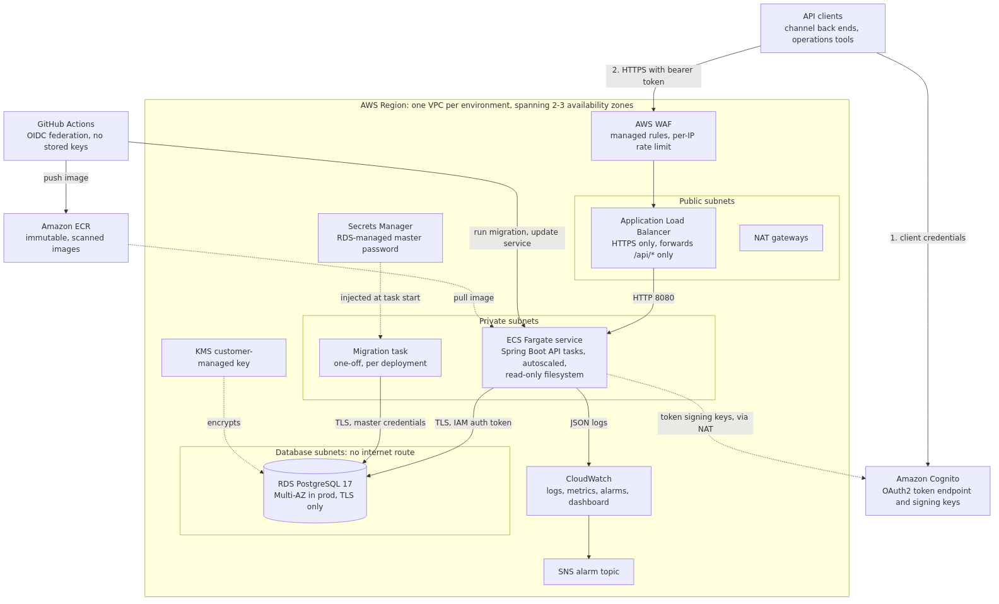

# Banking platform

A REST API for bank accounts — balances, deposits, withdrawals limited to 1,000 a day, and scheduled payments — together with the AWS infrastructure, delivery pipeline and operational tooling to run it in production.

| | |
|---|---|
| **Application** | Java 21, Spring Boot 4.1, PostgreSQL 17, Flyway |
| **Infrastructure** | Terraform: VPC, WAF, Application Load Balancer, ECS Fargate, RDS, Cognito, KMS, CloudWatch |
| **Delivery** | GitHub Actions with OIDC federation: test, scan, publish, migrate, roll out, smoke test; dev, then approved prod |
| **Quality** | Unit, web slice and Testcontainers integration tests with an 85% line coverage gate; tflint, Checkov, shellcheck, hadolint, Trivy |

## Contents

- [Architecture](#architecture)
- [Design decisions and trade-offs](#design-decisions-and-trade-offs)
- [Setup and run](#setup-and-run)
- [API documentation](#api-documentation)
- [Environment variables](#environment-variables)
- [Tests and sample data](#tests-and-sample-data)
- [Repository layout](#repository-layout)
- [Documentation](#documentation)

## Architecture



Clients authenticate with Amazon Cognito and call the API over HTTPS. WAF filters the traffic, the load balancer forwards only `/api/*` to Spring Boot tasks on ECS Fargate in private subnets, and those tasks reach PostgreSQL on RDS in subnets with no route to the internet. Database migrations run as a separate one-off task before each rollout, so the running application never holds credentials that can change the schema.

The diagram sources are in [docs/diagrams](docs/diagrams) and are rendered with `make diagrams`. More diagrams — the withdrawal request flow, the payment state machine and the delivery pipeline — are in [docs/ARCHITECTURE.md](docs/ARCHITECTURE.md) and [DESIGN.md](DESIGN.md).

## Design decisions and trade-offs

The full table, with the alternatives considered and what each choice costs, is in [docs/ARCHITECTURE.md §9](docs/ARCHITECTURE.md#9-decisions-and-trade-offs). The decisions that shape the code most:

| Decision | Why | What it costs |
|---|---|---|
| Every balance change goes through one ledger component while the account row is locked | Makes the balance and daily-limit checks correct under concurrent requests, which is the core risk in this domain | Requests on the same account are serialised |
| An append-only ledger alongside a balance column | Constant-time balance reads plus a complete audit trail, with a database check constraint that makes an overdraft impossible | Two representations; a reconciliation job is future work |
| The daily total is summed from the ledger rather than kept in a counter | One source of truth, nothing to keep in sync | An indexed aggregate query per withdrawal |
| Payments are executed by a scheduler in every task, claiming work with `SKIP LOCKED` | Any number of instances can run it safely without extra infrastructure | Execution happens within about 15 seconds of the due time |
| The application authenticates to the database with short-lived IAM tokens | No database password exists for the long-running application to leak, and rotation cannot break it | Requires the AWS JDBC wrapper |
| Migrations run as a separate task before the rollout | Schema credentials never reach the API; a failed migration stops the deployment before new code runs | Migrations must stay compatible with the previous release |
| ECS Fargate rather than EC2 or EKS | No servers to patch; rolling deployments with automatic rollback out of the box | Less control over hosts, higher unit cost than well-packed EC2 |
| Terraform, with one composed stack instantiated per environment | dev and prod differ only in sizing and safety settings, not in shape | State has to be bootstrapped and managed |

Trade-offs that were deliberately accepted, and the assumptions behind the business rules, are listed in [docs/ARCHITECTURE.md §10](docs/ARCHITECTURE.md#10-assumptions); the application-level design is explained in [DESIGN.md](DESIGN.md).

## Setup and run

### With Docker (recommended)

Requires Docker, `curl` and `jq`.

```bash
make up
```

This builds the image and starts three containers: PostgreSQL 17, a mock OAuth2 server standing in for Cognito, and the API on http://localhost:8080. The API container runs exactly as it does in AWS: non-root, with a read-only root filesystem.

```bash
export TOKEN=$(scripts/get-token.sh)
api() { curl -s -H "Authorization: Bearer $TOKEN" -H "Content-Type: application/json" "$@"; echo; }

ACCOUNT=$(api localhost:8080/api/v1/accounts -d '{"ownerName": "Ada Lovelace"}' | jq -r .id)
api localhost:8080/api/v1/accounts/$ACCOUNT/deposits    -d '{"amount": 2000.00}'
api localhost:8080/api/v1/accounts/$ACCOUNT/withdrawals -d '{"amount": 700.00}'
api localhost:8080/api/v1/accounts/$ACCOUNT/withdrawals -d '{"amount": 300.01}'   # 422: over the daily limit
api localhost:8080/api/v1/accounts/$ACCOUNT/balance
```

`make down` stops everything and deletes the local data. `make logs` follows the API logs.

To build or run the image by hand:

```bash
docker build -t banking-api .
docker run --rm -p 8080:8080 --read-only --tmpfs /tmp \
  -e SPRING_PROFILES_ACTIVE=local -e DB_HOST=host.docker.internal banking-api
```

### Without Docker

Requires Java 21 and a PostgreSQL 17 database. With the database reachable on `localhost:5432` (see [environment variables](#environment-variables) to point elsewhere):

```bash
./mvnw spring-boot:run
```

Flyway creates the schema at start-up in this profile. A token issuer is still needed for authenticated calls; the simplest option is `docker compose up -d oauth2`.

### On AWS

[docs/DEPLOYMENT.md](docs/DEPLOYMENT.md) is a step-by-step guide: bootstrap the account, publish the first image, create the dev environment, deploy, connect the pipeline, then production. It also covers rollback, log queries, scaling, teardown and troubleshooting.

## API documentation

| | |
|---|---|
| **Swagger UI** | http://localhost:8080/swagger-ui.html when running locally — click **Authorize** and paste the token from `make token` |
| **OpenAPI document** | [docs/openapi.json](docs/openapi.json) in this repository, or http://localhost:8080/v3/api-docs live (`make openapi` regenerates the file) |
| **Written reference** | [docs/API.md](docs/API.md): authentication, every endpoint with examples, the error codes, idempotency and paging conventions |
| **Postman collection** | [postman/](postman): every endpoint plus the rejection cases, with environments for local and AWS. Import it, or run the whole collection with `make postman`. |

Both the interactive documentation and the OpenAPI endpoint are disabled in AWS, where the load balancer only forwards `/api/*`.

Endpoints at a glance:

| Method | Path | Scope |
|---|---|---|
| `POST` | `/api/v1/accounts` | `accounts.write` |
| `GET` | `/api/v1/accounts/{accountId}` | `accounts.read` |
| `GET` | `/api/v1/accounts/{accountId}/balance` | `accounts.read` |
| `POST` | `/api/v1/accounts/{accountId}/deposits` | `accounts.write` |
| `POST` | `/api/v1/accounts/{accountId}/withdrawals` | `accounts.write` |
| `GET` | `/api/v1/accounts/{accountId}/transactions` | `accounts.read` |
| `POST` | `/api/v1/payments` | `payments.write` |
| `GET` | `/api/v1/payments/{paymentId}` | `payments.read` |
| `GET` | `/api/v1/payments?accountId=…` | `payments.read` |
| `POST` | `/api/v1/payments/{paymentId}/accept` | `payments.write` |
| `POST` | `/api/v1/payments/{paymentId}/cancel` | `payments.write` |

## Environment variables

### Application

Set by the ECS task definition in AWS ([`infra/modules/ecs-service`](infra/modules/ecs-service)) and by [docker-compose.yml](docker-compose.yml) locally.

| Variable | Default | Used by | Description |
|---|---|---|---|
| `SPRING_PROFILES_ACTIVE` | `local` | all | `local` (docker compose), `aws` (ECS service), `migrate` (migration task), `test` (integration tests) |
| `DB_HOST` | `localhost` | all | Database host. Required in `aws` and `migrate`. |
| `DB_PORT` | `5432` | all | Database port |
| `DB_NAME` | `banking` | all | Database name |
| `DB_USERNAME` | `banking` | `local`, `aws` | Database user. In AWS this is `banking_app`, which signs in with an IAM token instead of a password. |
| `DB_PASSWORD` | `banking` | `local` | Local database password. Not used in AWS. |
| `DB_MASTER_USERNAME` | — | `migrate` | Schema owner, injected by ECS from the RDS-managed Secrets Manager secret |
| `DB_MASTER_PASSWORD` | — | `migrate` | As above. Never set on the API tasks. |
| `JWT_ISSUER_URI` | `http://localhost:8090/banking` | all | Expected `iss` claim of access tokens |
| `JWT_JWK_SET_URI` | `http://localhost:8090/banking/jwks` | all | Where token signing keys are fetched from |
| `BANKING_BUSINESS_TIME_ZONE` | `UTC` | all | Time zone whose midnight resets the daily withdrawal limit, e.g. `Asia/Singapore` |
| `BANKING_DAILY_WITHDRAWAL_LIMIT` | `1000.00` | all | Maximum withdrawn per banking day, including executed scheduled payments |
| `BANKING_PAYMENT_ACCEPTANCE_WINDOW` | `P3D` | all | ISO-8601 duration that held payment funds wait for acceptance (dev uses `PT30M`) |
| `LOGGING_STRUCTURED_FORMAT_CONSOLE` | unset (plain text) | all | Set to `logstash` in AWS for JSON logs; the CloudWatch metric filters depend on it |
| `JAVA_TOOL_OPTIONS` | `-XX:MaxRAMPercentage=75 -XX:+ExitOnOutOfMemoryError` | all | JVM options; set in the image and the task definition |

Settings without an environment variable, such as the scheduler interval and batch size, are in [`application.yml`](src/main/resources/application.yml) under `banking.payments` and can be overridden with standard Spring properties.

### Scripts

| Variable | Used by | Description |
|---|---|---|
| `IMAGE` | `deploy.sh` | Full image reference to deploy, `<registry>/banking-api:<git-sha>` |
| `ECS_CLUSTER`, `ECS_SERVICE` | `deploy.sh` | Target cluster and service, e.g. `banking-dev` and `api` |
| `API_TASK_FAMILY`, `MIGRATION_TASK_FAMILY` | `deploy.sh` | Task definition families to register new revisions of |
| `API_BASE_URL` | `smoke-test.sh`, `seed-sample-data.sh` | Base URL of the environment; defaults to `http://localhost:8080` for seeding |
| `ALLOW_SELF_SIGNED_TLS` | `smoke-test.sh`, `seed-sample-data.sh` | `true` for environments without a domain name |
| `TOKEN_URL`, `CLIENT_ID`, `CLIENT_SECRET` | `get-token.sh`, `smoke-test.sh` | Cognito token endpoint and client credentials; default to the local mock server |
| `SCOPE` | `get-token.sh` | Scopes to request; defaults to all four |
| `TOKEN` | `seed-sample-data.sh` | An existing access token; one is fetched automatically if unset |

All of these come from `terraform output github_environment_variables` for a deployed environment, as described in [docs/DEPLOYMENT.md](docs/DEPLOYMENT.md#5-deploy-and-verify-dev).

## Tests and sample data

```bash
make test
```

Runs unit, web slice and integration tests and the coverage gate. Docker is required: the integration tests start a real PostgreSQL 17 with Testcontainers. The last run had 129 tests passing with 98% line coverage; the build fails below 85%.

| Layer | What it covers | Runs with |
|---|---|---|
| Unit | The daily limit (day boundaries, time zones, daylight saving), ledger postings, account invariants, the payment state machine, payment service decisions, scheduler batching | JUnit 6, Mockito |
| Web slice | Validation, error responses, request IDs, scope enforcement for every endpoint | MockMvc with Spring Security |
| Integration (`*IT`) | End-to-end API flows, simultaneous withdrawals, the midnight reset, payment execution and expiry, concurrent schedulers, database role privileges | Spring Boot, PostgreSQL 17 in Testcontainers |

Integration tests use a controllable clock and the `America/New_York` time zone, so date handling cannot pass by accident in UTC. Reports land in `target/surefire-reports`, `target/failsafe-reports` and `target/site/jacoco/index.html`.

The Postman collection doubles as an API-level regression suite. With the environment running:

```bash
make postman
```

It sends 26 requests and asserts 57 expectations — the happy paths and the rules that must hold, such as the
over-limit withdrawal being refused with advice to contact the bank, a retried deposit moving money only once,
and a held payment counting towards the daily limit. Each run creates its own accounts, so it can be repeated.

Individual tests:

```bash
./mvnw test -Dtest=DailyWithdrawalLimitTest      # one unit test
./mvnw verify -Dit.test=ScheduledPaymentApiIT    # one integration test
```

### Sample data

With the environment running (`make up`):

```bash
make seed
```

[`scripts/seed-sample-data.sh`](scripts/seed-sample-data.sh) creates three accounts with balances, a withdrawal and a deposit, a payment whose funds are already held awaiting acceptance, and a payment scheduled for tomorrow — all through the public API, so the same rules apply as for any client. It prints what it created:

```
Accounts
OWNER          ID                                          BALANCE    REMAINING
Ada Lovelace   9310c74d-369d-4ce5-8464-2af505e4882d        4525.50       450.00
Bob Martin     e5875173-5c48-4100-8730-e02119a6b8cd        1200.00      1000.00
Carol Shaw     89849e47-0a17-46c3-b038-4dbdf9cd42b1           0.00      1000.00

Payments
DESCRIPTION    ID                                           AMOUNT       STATUS  EXPIRES / EXECUTES AT
Invoice 1017   b96cd170-c9e5-4d7c-aa09-3c0f47421a21         300.00 PENDING_ACCEPTANCE  2026-09-15T00:53:25Z
Rent           5c865894-4143-4798-8afb-3316173bcc67         450.00    SCHEDULED  2026-09-13T09:00:00Z
```

Ada's remaining allowance shows the rule at work: 1,000.00 less the 250.00 withdrawal and the 300.00 held for the payment, with the 75.50 deposit not restoring any of it. The script can also seed a deployed environment by setting `API_BASE_URL` and the client credentials.

## Repository layout

```
├── README.md                           this file
├── DESIGN.md                           schema, concurrency, idempotency, errors, security, scalability
├── docs/
│   ├── ARCHITECTURE.md                 AWS architecture, delivery pipeline, trade-offs, cost
│   ├── DEPLOYMENT.md                   step-by-step setup and operations
│   ├── API.md                          API reference
│   ├── openapi.json                    generated OpenAPI document
│   ├── diagrams/                       diagram sources (*.mmd)
│   └── images/                         rendered diagrams (*.png)
├── src/main/java/com/example/banking    application: account, payment, common, config
├── src/main/resources/db/migration      Flyway migrations
├── src/test/java                        unit, web slice and integration tests
├── infra/
│   ├── bootstrap/                       once per account: state bucket, ECR, GitHub federation
│   ├── modules/                         network, database, load-balancer, ecs-service, auth, monitoring
│   ├── stack/                           one complete environment
│   └── environments/{dev,prod}/         environment sizing and remote state
├── .github/workflows/                   pipeline and reusable deployment workflow
├── postman/                             Postman collection and environment files
├── scripts/                             deploy, smoke test, token, seed
├── Dockerfile                           multi-stage, non-root, layered image
├── docker-compose.yml                   local environment
└── Makefile                             make help lists the targets
```

## Documentation

| Document | Contents |
|---|---|
| [DESIGN.md](DESIGN.md) | Database schema and ER diagram, concurrency and idempotency, error handling and retries, security, scalability and extensibility |
| [docs/ARCHITECTURE.md](docs/ARCHITECTURE.md) | AWS architecture and components, application structure, observability, delivery pipeline, decisions and trade-offs, cost |
| [docs/DEPLOYMENT.md](docs/DEPLOYMENT.md) | Setting up AWS and the pipeline, operations, troubleshooting |
| [docs/API.md](docs/API.md) | Authentication, endpoints, examples, error codes |
