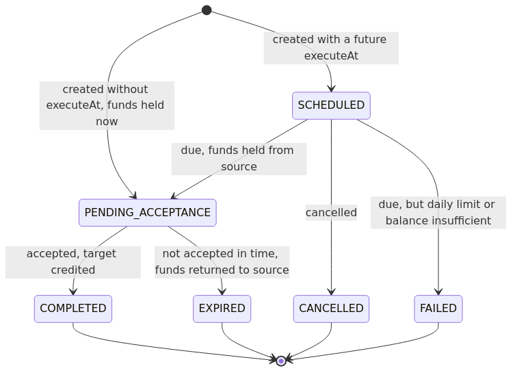
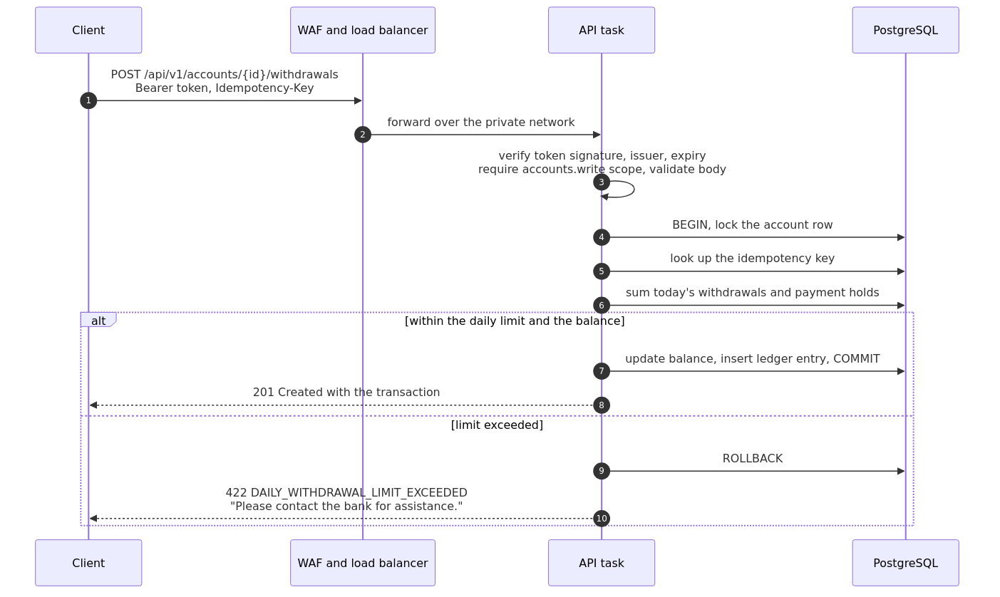
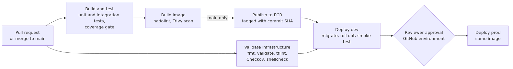

# Architecture

This document describes the banking platform: what it does, how it is built and run on AWS, and the reasoning behind the main decisions, including what each one costs.

1. [Requirements and how they are met](#1-requirements-and-how-they-are-met)
2. [System architecture](#2-system-architecture)
3. [Application design](#3-application-design)
4. [Data model](#4-data-model)
5. [Security](#5-security)
6. [Observability](#6-observability)
7. [Delivery pipeline](#7-delivery-pipeline)
8. [Reliability and scalability](#8-reliability-and-scalability)
9. [Decisions and trade-offs](#9-decisions-and-trade-offs)
10. [Assumptions](#10-assumptions)
11. [Cost](#11-cost)
12. [Future work](#12-future-work)

## 1. Requirements and how they are met

| Requirement | Implementation |
|---|---|
| Load balancer, application server, database server | Application Load Balancer, ECS Fargate service, RDS for PostgreSQL ([`infra/modules`](../infra/modules)) |
| Get the balance, deposit, withdraw | `GET …/balance`, `POST …/deposits`, `POST …/withdrawals` ([API reference](API.md)) |
| At most 1,000 withdrawn per day since 00:00; otherwise tell the customer to contact the bank | `DailyWithdrawalLimit`, enforced while holding the account's row lock; `422 DAILY_WITHDRAWAL_LIMIT_EXCEEDED` ([§3.3](#33-daily-withdrawal-limit)) |
| Bonus: scheduled payments, held until accepted or expired, subject to the daily limit | `ScheduledPayment` state machine, `PaymentService`, `PaymentScheduler`, migration `V2` ([§3.5](#35-scheduled-payments)) |
| Unit tests, TDD | Domain unit tests, MVC slice tests, and integration tests against real PostgreSQL (Testcontainers), with a coverage gate |
| Infrastructure as code | Terraform: account bootstrap, reusable modules, one composition per environment ([§2.4](#24-environments)) |
| CI/CD | GitHub Actions: test, validate, scan, publish, migrate, roll out, smoke test, approval for production ([§7](#7-delivery-pipeline)) |
| Firewalls, access control, encryption at rest and in transit | WAF, tiered subnets and security groups, least-privilege IAM and database roles, JWT scopes, KMS, TLS, no static credentials ([§5](#5-security)) |
| Monitoring and logging | Structured JSON logs, log-derived business metrics, CloudWatch alarms and dashboard ([§6](#6-observability)) |

## 2. System architecture

### 2.1 Diagram


### 2.2 Components

| Layer | Service | Configuration and rationale |
|---|---|---|
| Edge protection | AWS WAF | AWS managed rules (IP reputation, anonymous IPs, common exploits, known bad inputs including Log4j) and a per-IP rate limit. Logs to CloudWatch with the `Authorization` header redacted. |
| Load balancer | Application Load Balancer | Public subnets. HTTPS only, with a TLS 1.3/1.2 policy and no port 80 listener. Only `/api/*` is forwarded; every other path, including the management endpoints, gets a 404 from the load balancer. Invalid headers are dropped; access logs go to S3. |
| Application servers | ECS on Fargate (ARM64) | Private subnets across availability zones, no public IPs. At least two tasks, CPU target-tracking autoscaling, rolling deployments with automatic rollback, read-only root filesystem, non-root user, graceful shutdown. |
| Database | RDS for PostgreSQL 17 | Isolated subnets. Multi-AZ, 35-day point-in-time recovery and Performance Insights in prod; storage autoscaling; KMS encryption; TLS enforced by the server (`rds.force_ssl`). |
| Identity | Amazon Cognito | OAuth2 client credentials grant; resource server `banking-api` with four scopes; each client is limited to its own scopes. |
| Secrets and keys | Secrets Manager, KMS | RDS generates and rotates the master password in Secrets Manager; one customer-managed KMS key per environment, rotated yearly. |
| Observability | CloudWatch, SNS | Encrypted log groups with retention, metric filters, alarms, dashboard, Container Insights, VPC flow logs. |
| Delivery | ECR, GitHub Actions | One image repository shared by all environments (immutable tags, scan on push); pipeline federated to AWS with OIDC. |

### 2.3 Network

| Subnet tier | Contains | Routes |
|---|---|---|
| Public, /24 per AZ | Load balancer, NAT gateways | Internet gateway |
| Private, /20 per AZ | API tasks, migration task | Outbound only, through NAT; S3 gateway endpoint for image layers |
| Database, /24 per AZ | RDS | Within the VPC only |

Security groups reference each other rather than address ranges, so each tier accepts traffic only from the tier in front of it ([`security_groups.tf`](../infra/stack/security_groups.tf)):

```
clients ──443──▶ alb ──8080──▶ app ──5432──▶ database
                               app ──443───▶ AWS APIs and Cognito signing keys (through NAT)
```

The VPC's default security group is stripped of all rules, and VPC flow logs record all traffic.

### 2.4 Environments

[`infra/stack`](../infra/stack) defines a complete environment once. [`infra/environments/dev`](../infra/environments/dev) and [`prod`](../infra/environments/prod) instantiate it with different sizing and safety settings:

| Setting | dev | prod |
|---|---|---|
| Availability zones, NAT gateways | 2, one shared | 3, one per zone |
| API tasks (min to max), size | 2 to 4, 0.5 vCPU / 1 GiB | 3 to 10, 1 vCPU / 2 GiB |
| Database | db.t4g.micro, single-AZ, 7 days of backups | db.m7g.large, Multi-AZ, 35 days of backups, Performance Insights |
| Deletion protection and final snapshot | Off | On |
| Log retention | 30 days | 365 days |
| Payment acceptance window | 30 minutes, so expiry can be demonstrated | 3 days |
| Deployment | Automatic on merge to main | After reviewer approval; the same image as dev |

Resources shared by all environments in an account (Terraform state bucket, image repository, GitHub identity provider, image publisher role) are created once by [`infra/bootstrap`](../infra/bootstrap).

## 3. Application design

### 3.1 Structure

Java 21 and Spring Boot 4.1, organised by feature:

```
com.example.banking
├── account      Account, AccountTransaction (ledger entry), Ledger, DailyWithdrawalLimit, AccountService
│   └── api      AccountController, request and response records
├── payment      ScheduledPayment (state machine), PaymentService, PaymentScheduler
│   └── api      PaymentController, request and response records
├── common       Money, BusinessException, ErrorCode
│   └── web      problem-details error handler, request ID filter, idempotency key, paging
└── config       security (JWT scopes), typed business properties, clock, OpenAPI
```

Controllers translate HTTP into service calls; services define transactions; domain objects enforce their own invariants. Business rules live in plain classes that are unit tested without Spring or a database. All time comes from an injected `Clock`, so tests can move time across midnight or past a payment's expiry.

### 3.2 Money and the ledger

- Amounts are `BigDecimal` with exactly two decimal places, stored as `NUMERIC(19,2)`. An amount with more decimals is rejected, never rounded.
- An account keeps its current `balance` for fast reads. Every change to it is recorded, in the same database transaction, as an entry in the append-only `account_transactions` ledger, with the balance after the entry.
- `Ledger.post` is the only code path that changes a balance (`Account.credit` and `debit` are package-private), and it only runs inside an existing transaction (`Propagation.MANDATORY`).
- The database enforces what must hold regardless of application code: non-negative balances, positive amounts, valid entry types, payment references on payment entries, unique idempotency keys. The application's database role cannot update or delete ledger rows, which `DatabasePrivilegesIT` verifies.

### 3.3 Daily withdrawal limit

The limit applies to the total of **withdrawals and scheduled payments, counted when their funds are taken**, during the current banking day: midnight to midnight in the bank's time zone (`BANKING_BUSINESS_TIME_ZONE`), including days made shorter or longer by daylight saving changes.

```
remaining today = max(0, 1000.00 − sum of today's WITHDRAWAL and PAYMENT_HOLD ledger entries)
reject the request if its amount > remaining today
```

- The first withdrawal of the day may be up to 1,000.00.
- After withdrawing 500 and then 200, at most 300 more may be withdrawn that day. Deposits made in between do not change this.
- A rejected request gets `422` with `code` `DAILY_WITHDRAWAL_LIMIT_EXCEEDED`, the remaining allowance, and the message *"Please contact the bank for assistance."*
- The balance endpoint also returns `remainingDailyWithdrawalLimit`, so a client can tell the customer before they try.

The total is summed from the ledger using the `(account_id, created_at)` index, so there is one source of truth and nothing to keep in sync. The limit is configuration (`banking.daily-withdrawal-limit`).

### 3.4 Concurrency and idempotency

Every money movement runs while holding the account's row lock, which is what keeps the balance and daily-limit
checks correct when requests arrive at the same moment, and idempotency keys let clients retry safely after a
timeout. Both are covered in full, with the lock ordering table and the tests that prove them, in
[DESIGN.md §2](../DESIGN.md#2-concurrency-strategy) and [DESIGN.md §3](../DESIGN.md#3-idempotency-strategy).

### 3.5 Scheduled payments



- **Create** (`POST /payments`). Without `executeAt`, the funds are held immediately, so a breach of the limit or insufficient funds is returned to the caller (`422`) and no payment is created. With a future `executeAt` the payment is `SCHEDULED`; an amount above the daily limit is rejected up front because it could never succeed.
- **Execute.** When the payment is due, the scheduler takes the funds from the source account as a `PAYMENT_HOLD` ledger entry, counted against *that* day's limit. If the limit or the balance does not allow it, the payment becomes `FAILED`. The failure reason is kept neutral, because the target account can read the payment and must not learn the source's balance.
- **Accept** (`POST /payments/{id}/accept`). The target is credited (`PAYMENT_RECEIVED`). Accepting again returns the completed payment unchanged.
- **Expire.** At `expiresAt` (hold time plus the acceptance window) the scheduler returns the funds (`PAYMENT_REFUND`). If the target tries to accept after `expiresAt` but before the scheduler has run, the refund happens at once and the call returns `409 PAYMENT_EXPIRED`.
- **Cancel** is possible only while the payment is `SCHEDULED`. Once funds are held, the payment ends by acceptance or expiry.
- Refunded funds do not restore the daily allowance, just as deposits do not.

**Scheduler.** Every API task runs the job every 15 seconds. It claims one payment at a time with `SELECT … FOR UPDATE SKIP LOCKED`, processes it in its own transaction, and continues up to a batch size. Overdue holds are released before due payments execute, so returned funds are available to them. Any number of instances can run the job without coordination or double processing, and a failure affects only one payment, which is retried on the next run. `ScheduledPaymentApiIT` runs four schedulers at once to prove it.

### 3.6 Errors

Every error is an RFC 9457 problem response (`application/problem+json`) with a stable `code`, a readable `detail`, relevant fields such as `remainingToday`, and the `requestId`. Unexpected errors return a generic message; the details go only to the logs. See the [error reference](API.md#errors).

### 3.7 Request lifecycle

A withdrawal from the client to the database and back:



## 4. Data model

Three tables: `accounts`, the append-only `account_transactions` ledger, and `scheduled_payments`. The schema is
owned by versioned Flyway migrations and validated against the JPA mappings at start-up. The entity relationship
diagram, every column, constraint and index, and the rules for changing the schema are in
[DESIGN.md §1](../DESIGN.md#1-database-schema).

## 5. Security

Security spans the application and the infrastructure, so it is documented in one place:
[DESIGN.md §5](../DESIGN.md#5-security-considerations) covers the network tiers, API authentication and scopes,
least-privilege IAM and database roles, secrets, encryption at rest and in transit, runtime hardening, the supply
chain and the known gaps.

The infrastructure contributes these layers:

| Layer | Control |
|---|---|
| Edge | WAF managed rule sets and per-IP rate limiting; HTTPS only, with no port 80 listener; only `/api/*` is routed |
| Network | Three subnet tiers, security groups that reference each other, no public IPs on tasks, no internet route for the database |
| Identity | Cognito tokens with per-operation scopes; a separate IAM role for each task and each pipeline job, federated with OIDC |
| Data | A customer-managed KMS key per environment, TLS enforced by the database, and a database role that cannot rewrite the ledger |

## 6. Observability

### 6.1 Logs

- The application writes JSON logs (Logstash format) to CloudWatch Logs, one log group per component, encrypted and with retention.
- Every line carries a `requestId`: the client's `X-Request-Id`, otherwise the load balancer's `X-Amzn-Trace-Id`, otherwise a generated one. The ID is returned in a response header and in error bodies, so a customer's complaint leads straight to the relevant log lines.
- Every ledger posting emits an audit event (logger `banking.audit`, `event=ledger.posting`, with transaction, account and payment IDs, type and amount). Every rejected request emits `event=request.rejected` with its `code`, and payment state changes emit `payment.*` events.
- Also collected: load balancer access logs in S3, WAF logs, VPC flow logs, and PostgreSQL logs (connections and statements slower than one second).

For example, the requests rejected by the daily limit, in CloudWatch Logs Insights:

```
fields @timestamp, requestId, message
| filter code = "DAILY_WITHDRAWAL_LIMIT_EXCEEDED"
| sort @timestamp desc
```

### 6.2 Metrics and alarms

Metric filters derive metrics from the log events, without an agent or extra permissions: `ApplicationErrors`, `LedgerPostings`, `DailyLimitRejections` and `ScheduledPaymentFailures`. Load balancer, ECS (Container Insights), RDS and WAF metrics come from AWS.

| Alarm | Fires when |
|---|---|
| `alb-5xx`, `api-5xx` | More than 5 server errors a minute in 3 of 5 minutes |
| `api-latency-p95` | 95th percentile response time above 1 s in 3 of 5 minutes |
| `api-unhealthy-tasks` | Any task failing health checks for 3 minutes |
| `api-no-healthy-tasks` | No healthy task for 2 minutes |
| `api-cpu-high`, `api-memory-high` | Above 85% for 15 minutes, despite autoscaling |
| `api-application-errors` | More than 5 error log lines in 5 minutes |
| `database-cpu-high` | Above 80% for 15 minutes |
| `database-storage-low` | Less than 2 GiB free |
| `database-connections-high` | Above the environment's threshold |

Alarms and recoveries notify an encrypted SNS topic; set `alarm_email` to subscribe an address, or connect a paging tool. A CloudWatch dashboard shows traffic, errors, latency percentiles, task health, database load, business activity and WAF blocks.

### 6.3 Health checks

The load balancer checks `/actuator/health/readiness` on each task directly; the path is not routable from outside. Readiness deliberately does not include the database: a database outage should raise alarms, not make ECS replace every task in a loop.

## 7. Delivery pipeline



[`scripts/deploy.sh`](../scripts/deploy.sh) performs a deployment in the same way from the pipeline or a workstation:

1. Check the image exists in ECR.
2. Run the migrations: register a migration task definition revision with the new image, run it as a one-off Fargate task in the API's subnets, and stop the deployment if it fails.
3. Register an API task definition revision with the new image and update the service. ECS starts new tasks, waits for them to pass health checks, drains the old ones (30 s deregistration delay and graceful shutdown), and rolls back automatically if the new tasks keep failing (deployment circuit breaker).
4. Wait for the service to be stable and confirm the new revision is running. A rolled-back deployment is also "stable", so this check matters.
5. Smoke test through the load balancer.

**Migrations must stay compatible with the previous release**, because old tasks keep serving while new ones start. Breaking changes are split across releases (expand, deploy, then contract). The same rule makes rolling back, by redeploying the previous image, safe.

**Who owns what.** Terraform owns the infrastructure and the shape of the task definitions (CPU, memory, roles, environment variables). The pipeline owns which image runs. The ECS service ignores task definition changes in Terraform, and each deployment copies the latest revision, so infrastructure changes take effect at the next deployment. Infrastructure changes are applied by an operator with `terraform plan` and `apply` after review. The pipeline checks the infrastructure code but deliberately has no permission to change infrastructure.

## 8. Reliability and scalability

| Situation | Behaviour |
|---|---|
| A task crashes or fails health checks | The load balancer stops routing to it and ECS replaces it. |
| An availability zone fails | Tasks run in at least two zones and are rebalanced. In prod, the Multi-AZ database fails over to its synchronous standby, typically within one to two minutes and without losing committed transactions, and each zone has its own NAT gateway. |
| Traffic grows | Autoscaling adds tasks to hold average CPU at 60% (up to 10 in prod). The API is stateless; the database scales vertically. |
| A faulty release | The circuit breaker rolls it back automatically; an operator can redeploy any earlier image. |
| Data corruption or operator error | Point-in-time restore (35 days in prod), a final snapshot before deletion, deletion protection. |
| Abusive clients | WAF rate limiting and managed rules stop them before the application. |
| A task dies while processing a payment | Its transaction rolls back and releases the lock; another task processes the payment. |

Each task holds at most 10 database connections, so the maximum task count × 10 must stay below the database's connection limit (about 110 on `db.t4g.micro`). RDS Proxy is the next step if the task count grows substantially. The other capacity limits, and what to do when each is reached, are in [DESIGN.md §6](../DESIGN.md#6-scalability-and-future-extensibility).

## 9. Decisions and trade-offs

| Decision | Alternatives | Why | Cost of the choice |
|---|---|---|---|
| ECS on Fargate | EC2 Auto Scaling group; EKS | No servers to patch or right-size; native load balancer integration, rolling deployments and circuit breaker; much less to operate than Kubernetes for one service | Less control over hosts; higher unit price than well-packed EC2 |
| RDS for PostgreSQL | Aurora PostgreSQL; DynamoDB | ACID transactions, row locks, check and foreign key constraints suit a ledger; the cheapest managed option for small environments | Slower failover than Aurora (1–2 minutes versus usually under one); Aurora is the upgrade path |
| Row lock per account | Optimistic locking with retries; SERIALIZABLE isolation | Deterministic, no retry storms on double submissions; contention on one account is naturally low | Requests to the same account queue behind each other (bounded by timeouts) |
| Daily total summed from the ledger | A per-day counter row | One source of truth, simple to reason about, cheap with the index | One aggregate query per withdrawal; a counter suits more complex limits |
| Balance column plus immutable ledger | Balance derived only from the ledger | Constant-time balance reads and a database-enforced non-negative balance, with a full audit trail | Two representations to keep consistent; a reconciliation job is advisable |
| Scheduler inside the application, with `SKIP LOCKED` | EventBridge Scheduler with Lambda; SQS | No extra infrastructure; safe with any number of instances; transactional with the ledger | Payments execute within about 15 s of their due time; very high volumes would warrant a queue |
| IAM database authentication for the application; RDS-managed secret for migrations | One rotated Secrets Manager credential | The long-running application has no password to leak and rotation cannot break it; the application role cannot alter the schema or the ledger | Requires the AWS JDBC wrapper; IAM authentication suits up to about 200 new connections per second (ample with pooling) |
| Migrations as a separate task before rollout | Flyway at application start-up | Schema-owner credentials never reach the API; a failed migration stops the deployment before new code runs | An extra pipeline step; migrations must stay backward compatible |
| TLS terminated at the load balancer | End-to-end TLS to the tasks | Simple certificate management; the internal hop stays in private subnets behind security groups | Not zero trust inside the VPC; re-encrypting to the tasks is possible if policy requires it |
| Cognito client credentials with scopes | API keys; load balancer authentication; a custom identity provider | Standard OAuth2 JWTs verified locally, scopes per client, managed service | Machine-to-machine tokens are billed; customer identity not modelled yet |
| Rolling deployment with circuit breaker | Blue/green; canary | Zero downtime and automatic rollback with no extra infrastructure | Old and new versions briefly serve together; no bake time with traffic shifting |
| GitHub Actions with OIDC | AWS CodePipeline; Jenkins | Next to the code, no stored AWS keys, environment approvals built in | Depends on GitHub's availability |
| Terraform with a shared stack per environment | CloudFormation; CDK | Plan and review workflow, multiple providers, environments differ only in sizing | State must be managed (bootstrapped S3 backend with locking) |
| NAT gateways | VPC interface endpoints only | Tasks also need Cognito's public signing keys; simplest setup | NAT gateway cost; AWS API calls leave the VPC (over TLS) |
| ARM64 (Graviton) tasks | x86-64 | About 20% cheaper Fargate compute for a JVM workload | Images must be built for arm64 (done natively in CI, without emulation) |

## 10. Assumptions

- There is one currency, and amounts have at most two decimal places.
- A "day" is the calendar day in the bank's configured time zone (UTC by default), not a rolling 24 hours and not the customer's time zone.
- The daily limit counts withdrawals and scheduled payments at the moment their funds are taken. Deposits, received payments and refunds of expired payments do not restore the allowance.
- A scheduled payment counts towards the day on which it actually executes; the scheduler runs every 15 seconds.
- Only a payment that has not yet executed can be cancelled.
- API clients are trusted applications authorised by scope and are responsible for authenticating the end customer ([DESIGN.md §5](../DESIGN.md#known-gaps)).
- Accounts cannot be closed through the API.

## 11. Cost

A rough monthly estimate at us-east-1 on-demand prices, before data transfer and free tier. Confirm with the AWS Pricing Calculator before relying on it.

| Item | dev | prod |
|---|---|---|
| NAT gateways | ~$35 (one) | ~$100 (three) |
| Load balancer | ~$20 | ~$25 and up |
| Fargate, minimum task count | ~$30 (2 × 0.5 vCPU, 1 GiB) | ~$90 (3 × 1 vCPU, 2 GiB) |
| RDS | ~$15 (db.t4g.micro) | ~$270 (db.m7g.large Multi-AZ, 100 GiB) |
| WAF | ~$11 | ~$11 and up |
| CloudWatch: logs, alarms, dashboard, Container Insights | ~$15 | ~$50 |
| KMS, Secrets Manager, Cognito, ECR | ~$5 | ~$10 |
| **Total** | **about $130** | **about $560** |

The biggest levers are NAT gateways (interface endpoints or a shared egress VPC), database size, Compute Savings Plans, and stopping dev outside working hours.

## 12. Future work

The prioritised roadmap — customer-level authorisation, ledger reconciliation, per-customer limits, RDS Proxy and
Aurora, domain events through an outbox, blue/green deployments, tracing and multi-region recovery — is in
[DESIGN.md §6](../DESIGN.md#6-scalability-and-future-extensibility).
